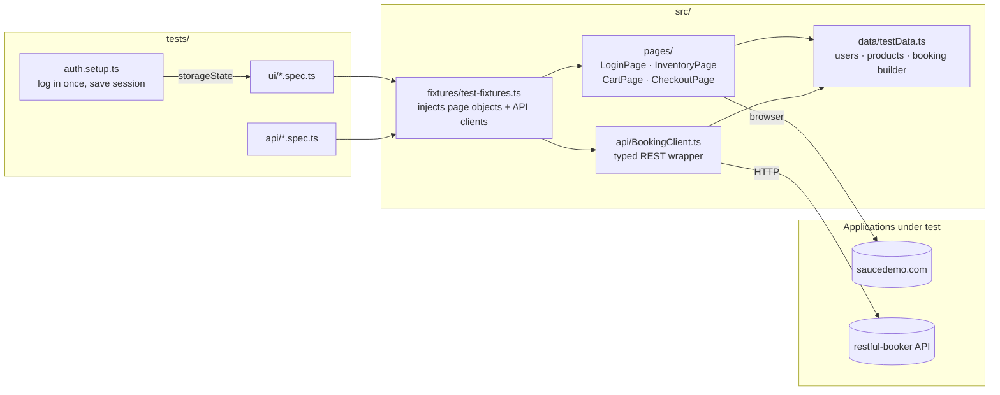
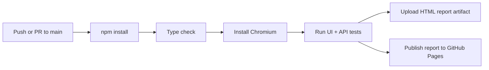

# Playwright + TypeScript Test Automation Framework

[](https://github.com/coderfreck/playwright-typescript-framework/actions/workflows/playwright.yml)
[](https://coderfreck.github.io/playwright-typescript-framework/)

An end-to-end test automation framework covering both **UI** and **REST API** testing, built with [Playwright](https://playwright.dev) and TypeScript. It runs on every push through GitHub Actions and publishes an HTML report to GitHub Pages.

| Layer | Application under test | What's covered |
|-------|------------------------|----------------|
| UI | [Sauce Demo](https://www.saucedemo.com) (e-commerce) | Login, validation, sorting, cart, checkout |
| API | [Restful Booker](https://restful-booker.herokuapp.com/apidoc/index.html) (hotel bookings) | Auth, CRUD, filtering, negative cases |

**Latest test report:** https://coderfreck.github.io/playwright-typescript-framework/

## Architecture



**How a test runs:** a spec asks for fixtures such as `inventoryPage` or `authedBookingClient`. The custom fixture file builds those objects for each test, so specs contain only test intent. Page objects hold all locators and page actions. The API client hides endpoints, headers and auth.

### CI pipeline



## Project structure

```
.
├── .github/workflows/playwright.yml   # CI: type check, test, publish report
├── playwright.config.ts               # projects (setup, ui, api), reporters, retries
├── src/
│   ├── api/BookingClient.ts           # restful-booker API wrapper
│   ├── data/testData.ts               # test users, products, booking builder
│   ├── fixtures/test-fixtures.ts      # custom Playwright fixtures
│   └── pages/                         # Page Object Model
│       ├── LoginPage.ts
│       ├── InventoryPage.ts
│       ├── CartPage.ts
│       └── CheckoutPage.ts
└── tests/
    ├── auth.setup.ts                  # logs in once, saves storage state
    ├── ui/
    │   ├── login.spec.ts
    │   └── shopping.spec.ts
    └── api/
        └── booking.spec.ts
```

## Key design decisions

- **Page Object Model.** Locators live in one place, so a UI change means one fix. Tests read like user journeys.
- **Custom fixtures over `beforeEach` boilerplate.** Tests declare what they need (`{ cartPage, checkoutPage }`) and Playwright builds it.
- **Login once with a setup project.** `auth.setup.ts` saves the session to `storageState`, and the shopping tests reuse it. This cuts run time and keeps login tests separate from the rest.
- **Stable locators.** The framework prefers `data-test` attributes (`testIdAttribute: 'data-test'`) and role-based locators over brittle CSS paths.
- **Independent, parallel-safe API tests.** Each test creates its own booking with unique data (`buildBooking()`), so tests never depend on each other or on existing records.
- **Data-driven cases.** Login validation runs from a small table of inputs and expected errors.
- **Debuggable failures.** On CI, failed tests retry and collect a trace, screenshot and video, all viewable in the HTML report.
- **Configurable environments.** Base URLs and credentials can be overridden with `UI_BASE_URL`, `API_BASE_URL`, `API_USERNAME` and `API_PASSWORD`.

## Getting started

Requirements: Node.js 20 or later.

```bash
git clone https://github.com/coderfreck/playwright-typescript-framework.git
cd playwright-typescript-framework
npm install
npx playwright install chromium
```

## Running tests

| Command | What it does |
|---------|--------------|
| `npm test` | Run everything (UI + API) |
| `npm run test:ui` | UI tests only |
| `npm run test:api` | API tests only |
| `npm run test:smoke` | Tests tagged `@smoke` |
| `npm run test:headed` | UI tests with a visible browser |
| `npm run report` | Open the last HTML report |
| `npm run typecheck` | TypeScript type check |

## CI/CD

The [workflow](.github/workflows/playwright.yml) runs on every push and pull request to `main`:

1. Installs dependencies and runs a TypeScript type check
2. Installs Chromium and runs all Playwright projects
3. Uploads the HTML report as a build artifact (kept 14 days)
4. On `main`, publishes the report to [GitHub Pages](https://coderfreck.github.io/playwright-typescript-framework/)

## Test coverage

**UI (Sauce Demo)**
- Successful login, locked-out user, wrong password, required-field validation
- Redirect to login when opening a protected page signed out
- Product sorting by price and by name
- Cart badge updates on add and remove
- Full checkout with price and tax checks
- Checkout form validation

**API (Restful Booker)**
- Health check and token authentication (valid and invalid)
- Create, read, full update, partial update and delete a booking
- Filter bookings by guest name
- Updates without a token are rejected with 403

## Author

**Vaibhav Asthana**, Quality Assurance Engineer
[LinkedIn](https://www.linkedin.com/in/vaibhav-asthana-638a74369/) · [Portfolio](https://coderfreck.github.io)
